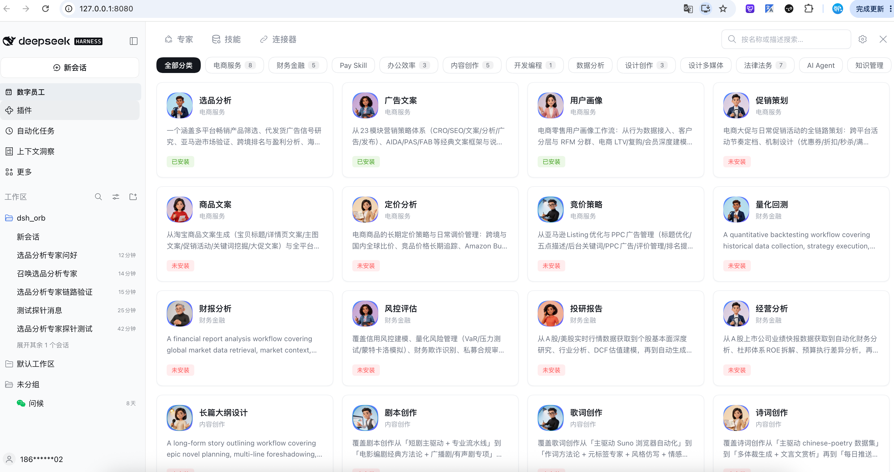
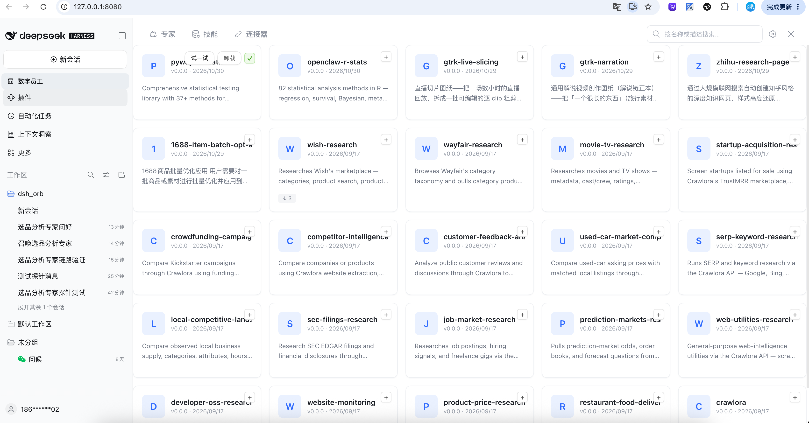
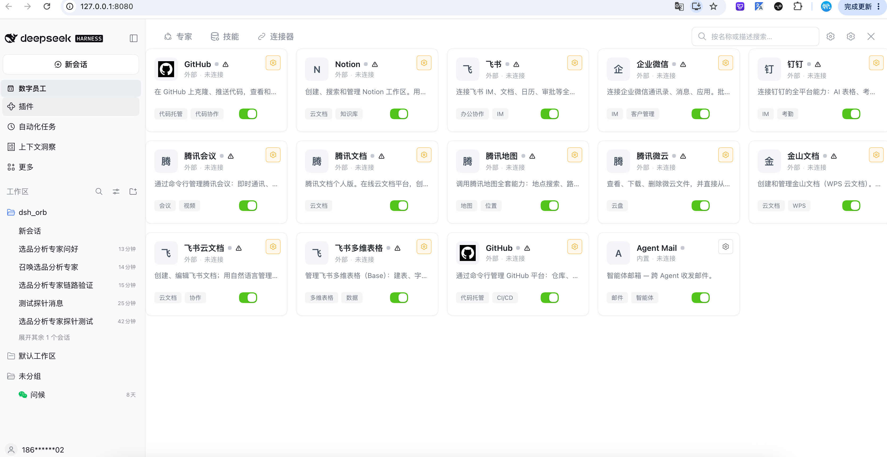
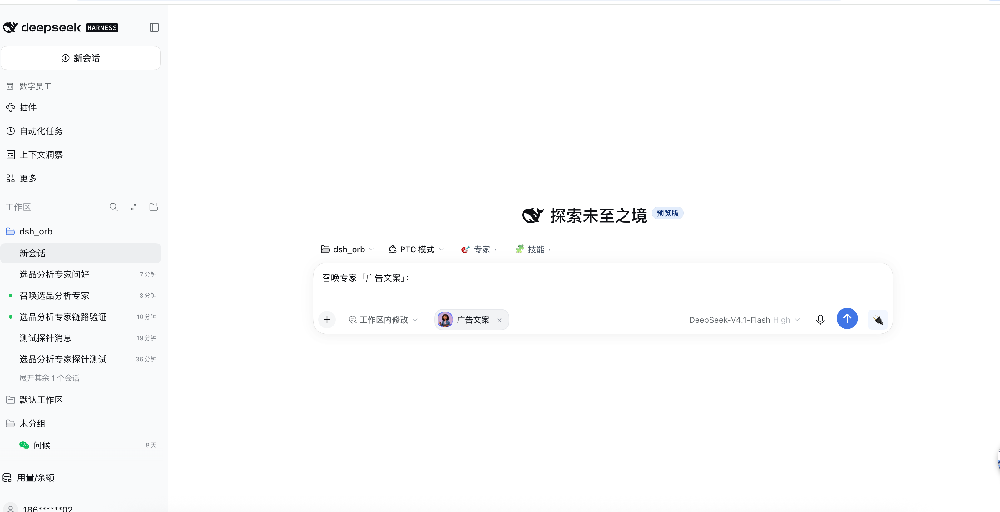
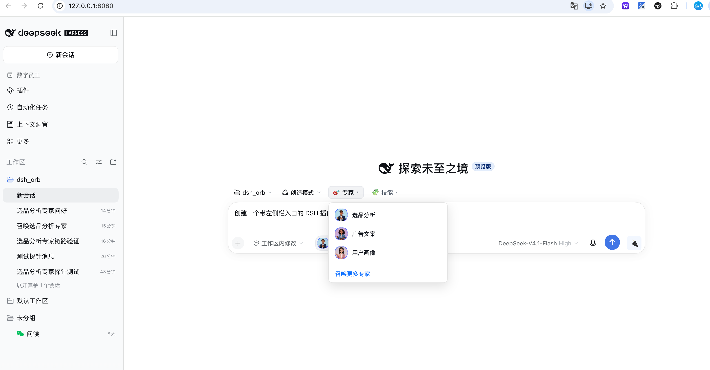

# @deepseek-ai/dsh-employee-marketplace

[](LICENSE)
[](https://www.npmjs.com/package/@deepseek-ai/dsh-employee-marketplace)

**English** | [中文](README.zh.md)

A **Marketplace** panel for the DeepSeek Harness web client. It surfaces three
catalogs — **Experts**, **Skills**, and **Connectors** — sourced from the
[skill.dualpaw.com](https://skill.dualpaw.com) registry, and lets you browse,
favorite, summon (invoke), and publish directly from the chat UI.

The plugin is a self-contained Cordis plugin: it registers only the `locale`
capability and DOM-injects its own sidebar entry and center-column panel. No
host gateway or slot changes are required.

---

## Overview

The Marketplace plugin adds a new sidebar entry below **Skill Center**.
Toggling it takes over the center column with a three-tab panel:

| Tab | What it shows |
| --- | --- |
| **Experts** | Category rail on the left, expert cards on the right. Hover a card to reveal the **Summon** button. |
| **Skills** | Searchable list of publishable skills, with a **Publish skill** toolbar action. |
| **Connectors** | Connector catalog; each connector can pre-fill the composer and expose a per-connector toggle chip. |

An invocation bridge listens for `dsh:invoke-expert` / `dsh:invoke-skill` /
`dsh:connector-fill` window events emitted by the list/detail components. It
pre-fills the composer, shows a "current expert / current skill" badge, and
injects a 🔌 chip next to the composer that pops up a per-connector toggle
popover.

---

## Features

### 1. Auto-load on tab open
Clicking the Experts or Skills tab lazily loads its catalog from the upstream
registry the first time the tab is shown (`loadExperts()` / `loadSkills()`),
so the panel opens instantly and fetches data on demand.

### 2. ⚙ Parameters — token + registration
A **⚙** icon in the panel header opens the shared **Parameters** dialog
(`MarketplaceSettingsDialog`). There you can:

- Paste your API token (stored **locally on this device only**).
- Jump straight to the sign-up / token page:
  **<https://skill.dualpaw.com/register>**


The token is the single credential that gates every upstream mutation —
favoriting an expert, publishing a skill, and connectors that require real
auth. Local-only actions (download / summon) are unaffected.

### 3. Favorites (gated on token)
Once a token is present, expert and skill cards show a **♥ favorite** corner
button. Favoriting is a no-op until a token is saved, so the UI stays honest
about which actions will actually persist.

### 4. Publish a skill (gated on token)
With a token saved, the Skills tab toolbar reveals a **Publish skill**
button that opens `PublishSkillDialog`. Enter a name, description, and
instructions, then submit — the plugin `POST`s to `/skills` on the registry and
refreshes the skill list. Publishing without a token is blocked up front with a
clear hint.

### 5. Hover → Summon with auto-install + "Installed" tag
Hovering an expert card reveals the **Summon** button:

- The button prefix icon shows install state — **✓ Installed** / **⊘ Not installed**
  — and flips the moment you click.
- Clicking Summon on a not-yet-installed expert first calls `installExpert`,
  showing **Downloading** / **Summoning** inside the same
  button, then auto-downloads the expert's bundled skills atomically and
  dispatches the `dsh:invoke-expert` event so the composer takes over as usual.
- Installed experts keep an **Installed** tag on the card.

---

## Screenshots

### Experts tab

Category rail on the left, expert card grid on the right — installed / not-installed
states at a glance:



### Skills tab

Searchable skill list with one-click "Try it" action:



### Connectors tab

Connector catalog with per-connector toggle switches:



### Hover → Summon (composer pre-fill)

After clicking **Summon** on an expert card, the composer is pre-filled and
the expert chip is injected:



### Expert quick picker

The expert drop-down next to the composer lets you quickly switch between
installed experts:



---

## Environment & Prerequisites

| Requirement | Version |
| --- | --- |
| Node.js | `^22.19 \|\| >=24` |
| Package manager | `pnpm` |
| React | `^18.2.0` (peer) |
| DeepSeek API key | Optional — only for running the host harness with live agents |

The plugin itself is pure front-end; it talks to `skill.dualpaw.com` through
its own CORS relay in `src/client/api.ts`, which falls back to mock data when
the registry is unreachable. No build-time secrets are required.

This package is a standalone repository built with `tsdown` — no monorepo
dependency.

---

## Installation

### 1. Prerequisites

| Requirement | Version | Notes |
| --- | --- | --- |
| Node.js | `^22.19 \|\| >=24` | Runtime for the dsh CLI |
| pnpm | `>=9` | Package manager used by dsh |
| dsh CLI | latest | DeepSeek Harness CLI (install below on first use) |
| React | `^18.2.0` (peer) | Provided by the dsh host — no separate install needed |

**Install the dsh CLI** (if you don't have it yet):

```sh
# Install pnpm (skip if already installed)
npm install -g pnpm

# Set up pnpm's global bin directory (one-time)
pnpm setup
source ~/.zshrc

# Install dsh CLI
pnpm add -g @deepseek-ai/dsh

# Verify
dsh --version
```

> If you see `ERR_PNPM_NO_GLOBAL_BIN_DIR`, run `pnpm setup` followed by
> `source ~/.zshrc` and retry.

---

### 2. Install the plugin into dsh web (end users)

Install the latest plugin version into the `web` profile directly from npm or GitHub:

```sh
# Install from GitHub (recommended, stays in sync with this repo)
dsh plugin --profile web add github:open-dshai/dsh-employee

# Or install from npm
# dsh plugin --profile web add @deepseek-ai/dsh-employee-marketplace
```

Then start dsh web:

```sh
dsh web --port 8080
# Your browser opens http://127.0.0.1:8080 automatically
```

Toggle the **Marketplace** entry in the sidebar to open the panel.

---

### 3. Install from local source (developers)

If you want to hack on the plugin and test changes live:

#### 3.1 Clone and install dependencies

```sh
git clone https://github.com/open-dshai/dsh-employee.git
cd dsh-employee
pnpm install
```

#### 3.2 Build the bundles

```sh
pnpm bundle
```

This produces:

- `lib/index.js` — Node-side entry (loaded by the host).
- `lib/client.js` — Browser-side bundle (loaded by `dsh web`).

> ⚠️ The running web client loads the **compiled `lib/client.js`**, not `src/`.
> After editing `src/`, re-run `pnpm bundle` (and restart `dsh web`) for changes
> to appear. During development you can use `pnpm watch` for automatic rebuilds.

#### 3.3 Link the local directory into the dsh web profile

Use `dsh plugin add` to link your local source directory into the web profile (recommended):

```sh
dsh plugin --profile web add /absolute/path/to/dsh-employee
```

Replace `/absolute/path/to/dsh-employee` with the absolute path to your cloned
source directory.

> ⚠️ If you see `ERR_PNPM_UNEXPECTED_STORE` or `ERR_PNPM_INVALID_VERSION_UNION`,
> your global pnpm is too old. Run `pnpm add -g pnpm@latest` to upgrade, then retry.

Then restart dsh web:

```sh
dsh web --port 8080
```

From then on, the cycle is: edit source → `pnpm bundle` → refresh the browser.

---

### 4. Uninstall

```sh
dsh plugin --profile web remove @deepseek-ai/dsh-employee-marketplace
```

---

## Usage

1. Open the **Marketplace** sidebar entry.
2. Pick a tab — **Experts / Skills / Connectors**.
3. Click **⚙** in the panel header to open **Parameters**:
   - Paste your API token, or
   - Follow the link to <https://skill.dualpaw.com/register> to get one.
4. With a token saved:
   - **♥** favorite experts / skills.
   - On the **Skills** tab, click **Publish skill** to publish a new skill.
5. Hover an expert card and click **Summon** to install (if needed) and invoke it.
   Installed experts show an **Installed** tag.

---

## Project layout

```
dsh-employee/
├── src/
│   ├── index.ts                    # Node entry (install/uninstall skill routes)
│   └── client/
│       ├── index.ts                # Browser plugin entry (apply + inject)
│       ├── store.ts                # MarketplaceStore (catalogs, install, favorite, publish)
│       ├── api.ts                  # CORS relay to skill.dualpaw.com + mock fallback
│       ├── MarketplaceController.ts # panel open/close + single-occupant coordination
│       ├── MarketplacePanel.tsx    # the three-tab center panel
│       ├── ExpertsTab.tsx          # experts grid + hover invoke + favorite
│       ├── SkillsTab.tsx           # skills list + publish/try-it actions
│       ├── ConnectorsTab.tsx       # connector catalog + composer chip
│       ├── MarketplaceSettingsDialog.tsx # ⚙ Parameters (token + register link)
│       ├── PublishSkillDialog.tsx  # publish-skill dialog (token-gated)
│       ├── invoke.ts               # invocation bridge (dsh:invoke-* events)
│       ├── locales.ts              # en / zh i18n dictionaries
│       └── styles.module.css       # CSS modules
├── lib/                            # build output (tsdown) — do not edit by hand
├── tsdown.config.ts                # tsdown config (dual entry)
├── tsdown.css-plugin.ts            # CSS Modules inline plugin
├── tsdown.client-plugin.ts         # __ModuleLoader__ wrapper plugin
├── .npmrc                          # npm registry config
└── package.json
```

---

## Disclaimer

This plugin is an independent community contribution and is **not** an official
product of DeepSeek AI. The upstream registry at `skill.dualpaw.com` is operated
by a third party; your API token is stored only in your local browser. Use at
your own risk and review the source before running it against any production
environment.

MIT License. See [LICENSE](LICENSE).
