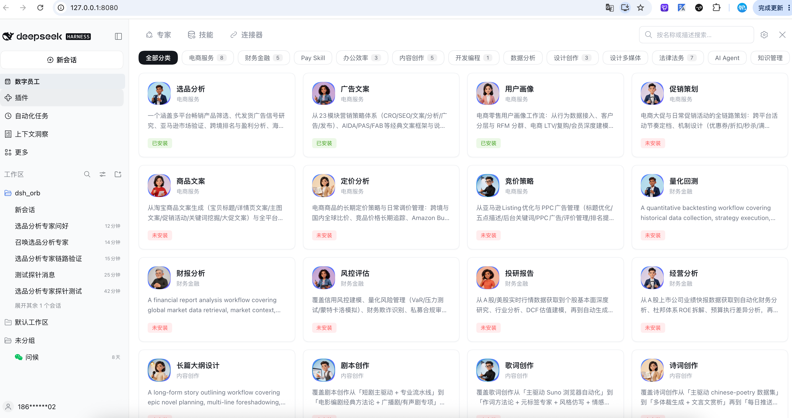
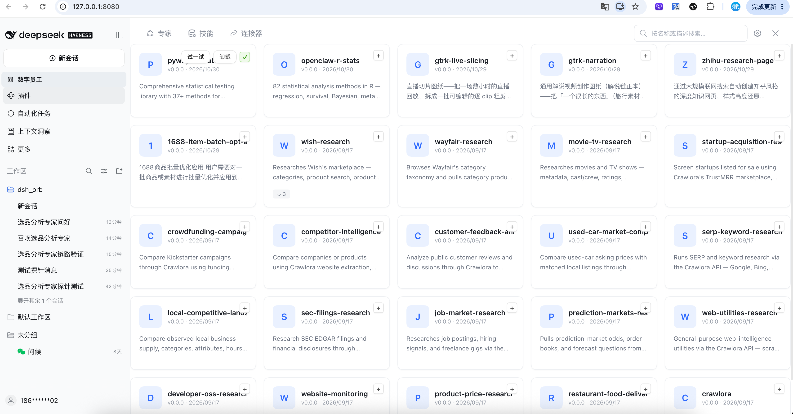
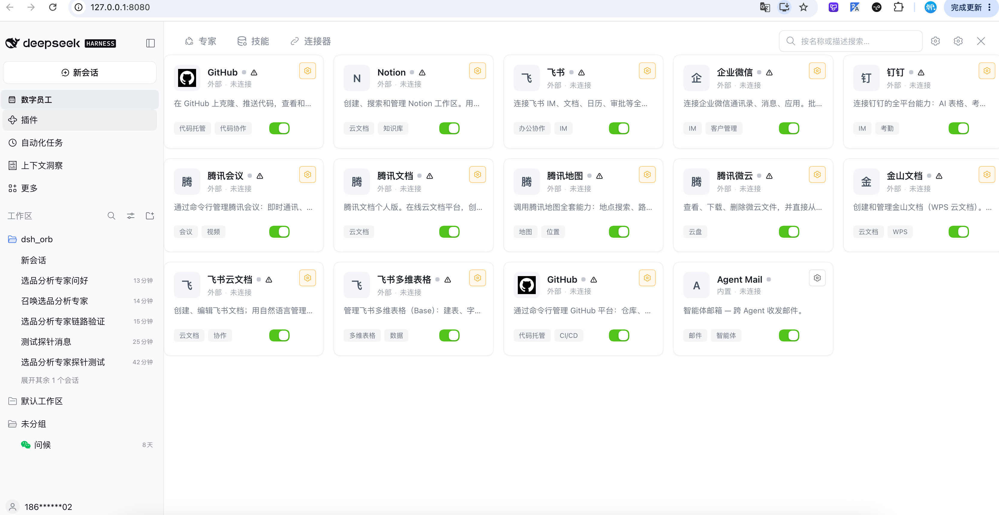
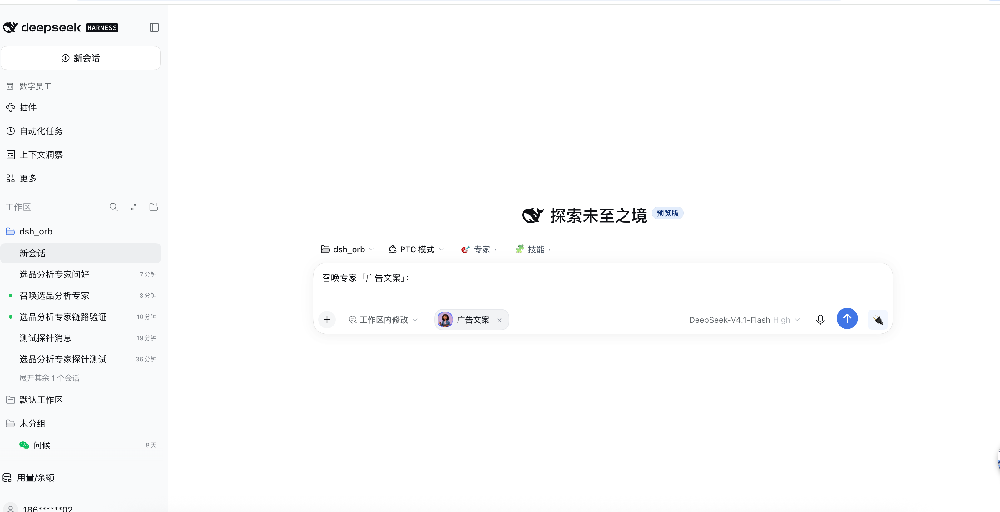
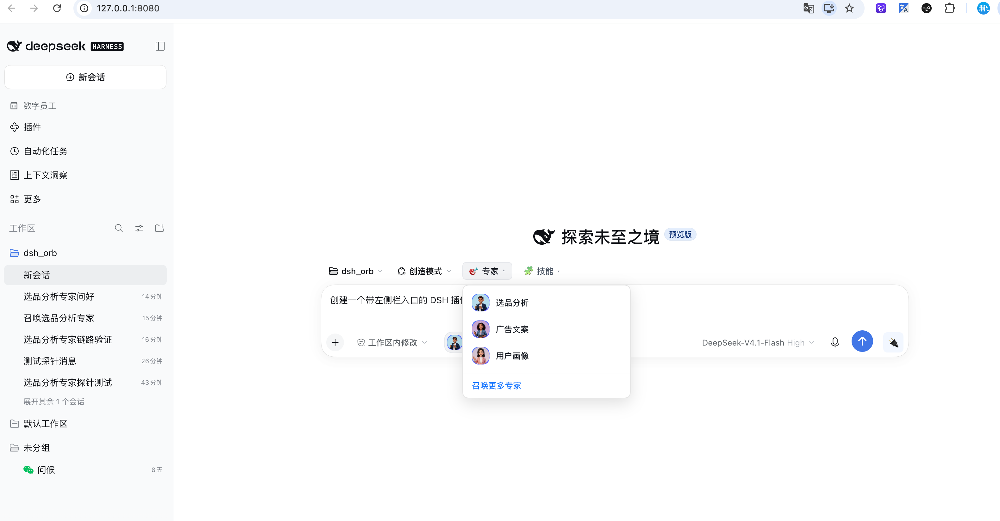

# @deepseek-ai/dsh-employee-marketplace

[](LICENSE)
[](https://www.npmjs.com/package/@deepseek-ai/dsh-employee-marketplace)

[English](README.md) | **中文**

DeepSeek Harness Web 客户端的**应用市场**面板插件。它整合了三大目录 ——
**专家（Experts）**、**技能（Skills）** 与 **连接器（Connectors）**，数据来源于
[skill.dualpaw.com](https://skill.dualpaw.com) 注册中心，并支持在对话界面中直接
浏览、收藏、召唤（调用）与发布。


本插件是一个自包含的 Cordis 插件：仅注册 `locale` 能力，并通过
DOM 注入自己的侧边栏入口与中栏面板，**无需改动宿主网关或任何 slot**。

---

## 简介

应用市场插件在「技能中心」下方新增一个侧边栏入口。点击后接管中栏，展示三标签页面板：

| 标签页 | 内容 |
| --- | --- |
| **专家（Experts）** | 左侧分类栏 + 右侧专家卡片。悬浮卡片即可唤出 **召唤** 按钮。 |
| **技能（Skills）** | 可搜索的技能列表，工具栏提供 **发布技能** 操作。 |
| **连接器（Connectors）** | 连接器目录；每个连接器可预填对话框，并注入一个 🔌 切换芯片。 |

调用桥（invocation bridge）监听列表/详情组件派发的 `dsh:invoke-expert` /
`dsh:invoke-skill` / `dsh:connector-fill` 窗口事件：它会预填对话框、显示
「当前专家 / 当前技能」标识，并在对话框旁注入一个 🔌 芯片，弹出每连接器的开关浮层。

---

## 功能特性

### 1. 点击标签页自动加载
首次打开专家或技能标签页时，会按需从上游注册中心拉取对应目录
（`loadExperts()` / `loadSkills()`），面板秒开、数据懒加载。

### 2. ⚙ 参数设置 —— Token 与注册入口
面板头部的 **⚙** 图标打开共享的 **参数设置** 对话框
（`MarketplaceSettingsDialog`），可：

- 粘贴你的 API Token（**仅保存在本机**）。
- 一键跳转注册 / 获取 Token 页面：
  **<https://skill.dualpaw.com/register>**

Token 是解锁所有「写操作」的唯一凭证 —— 收藏专家、发布技能、需要真实鉴权的
连接器。纯本地操作（下载 / 召唤）不受 Token 影响。

### 3. 收藏（受 Token 限制）
保存 Token 后，专家与技能卡片会显示 **♥ 收藏** 角标按钮。未保存 Token 时
收藏是空操作，让界面如实反映「哪些操作真的会生效」。

### 4. 发布技能（受 Token 限制）
保存 Token 后，技能标签页工具栏显示 **发布技能** 按钮，打开
`PublishSkillDialog`。填写名称、描述与指令后提交，插件向注册中心 `/skills`
发起 `POST` 并刷新技能列表。未保存 Token 时会前置拦截并给出明确提示。

### 5. 悬浮 → 召唤（自动安装 + 「已安装」标识）
悬浮专家卡片即唤出 **召唤** 按钮：

- 按钮前缀图标显示安装状态 —— **✓ 已安装** / **⊘ 未安装**，点击瞬间翻转。
- 点击未安装专家的「召唤」会先调用 `installExpert`，按钮内显示
  **下载中 / 召唤中**，随后原子化自动下载该专家捆绑的技能，并派发
  `dsh:invoke-expert` 事件，由对话框接管后续流程。
- 已安装专家在卡片上保留 **已安装** 标识。

---

## 界面截图

### 专家标签页

左侧分类栏 + 右侧专家卡片网格，已安装/未安装状态一目了然：



### 技能标签页

可搜索的技能列表，支持一键「试一试」：



### 连接器标签页

连接器目录，每个连接器可独立开关：



### 悬浮 → 召唤（预填对话框）

点击专家卡片的「召唤」按钮后，对话框自动预填并注入专家芯片：



### 专家快速选择

对话框旁的专家下拉菜单，快速切换已安装专家：



---

## 环境准备

| 依赖项 | 版本要求 |
| --- | --- |
| Node.js | `^22.19 \|\| >=24` |
| 包管理器 | `pnpm` |
| React | `^18.2.0`（peer） |
| DeepSeek API Key | 可选 —— 仅宿主以真实 Agent 运行 web 时需要 |

插件本身为纯前端，通过 `src/client/api.ts` 中的自有 CORS 中继访问
`skill.dualpaw.com`，注册中心不可达时回退到 Mock 数据，构建期无需任何密钥。

本包为独立仓库，使用 `tsdown` 构建，不依赖 monorepo。

---

## 安装

### 1. 前置条件

| 依赖项 | 版本要求 | 说明 |
| --- | --- | --- |
| Node.js | `^22.19 \|\| >=24` | dsh CLI 的运行时 |
| pnpm | `>=9` | dsh CLI 的包管理器 |
| dsh CLI | 最新版 | DeepSeek Harness 命令行工具（首次安装见下） |
| React | `^18.2.0`（peer） | 由 dsh 宿主提供，无需单独安装 |

**安装 dsh CLI**（如尚未安装）：

```sh
# 安装 pnpm（如已有 pnpm 可跳过）
npm install -g pnpm

# 配置 pnpm 全局 bin 目录（首次执行即可）
pnpm setup
source ~/.zshrc

# 安装 dsh CLI
pnpm add -g @deepseek-ai/dsh

# 验证
dsh --version
```

> 若遇到 `ERR_PNPM_NO_GLOBAL_BIN_DIR` 错误，请执行 `pnpm setup` 并 `source ~/.zshrc` 后重试。

---

### 2. 安装插件到 dsh web（普通用户）

直接从 npm 或 GitHub 安装最新版插件到 `web` profile：

```sh
# 从 GitHub 安装（推荐，与仓库同步）
dsh plugin --profile web add github:open-dshai/dsh-employee

# 或从 npm 安装
# dsh plugin --profile web add @deepseek-ai/dsh-employee-marketplace
```

安装完成后启动 dsh web：

```sh
dsh web --port 8080
# 浏览器会自动打开 http://127.0.0.1:8080
```

在侧边栏点击 **应用市场** 入口即可打开面板。

---

### 3. 从本地源码安装（开发者）

如果你想修改插件源码并实时调试，请按以下步骤操作：

#### 3.1 克隆源码并安装依赖

```sh
git clone https://github.com/open-dshai/dsh-employee.git
cd dsh-employee
pnpm install
```

#### 3.2 构建产物

```sh
pnpm bundle
```

这会生成：
- `lib/index.js` — Node 端入口（宿主加载）
- `lib/client.js` — 浏览器端产物（web 客户端加载）

> ⚠️ 运行中的 web 客户端加载的是**编译后的 `lib/client.js`**，而非 `src/`。
> 修改 `src/` 后必须重新执行 `pnpm bundle`（并重启 `dsh web`）改动才会生效。
> 开发时可用 `pnpm watch` 开启监听模式自动重新构建。

#### 3.3 将本地目录链接到 dsh web profile

使用 `dsh plugin add` 命令将本地源码目录链接到 web profile（推荐）：

```sh
dsh plugin --profile web add /absolute/path/to/dsh-employee
```

将 `/absolute/path/to/dsh-employee` 替换为你的源码目录绝对路径。

> ⚠️ 若遇到 `ERR_PNPM_UNEXPECTED_STORE` 或 `ERR_PNPM_INVALID_VERSION_UNION` 错误，
> 说明全局 pnpm 版本过低。请执行 `pnpm add -g pnpm@latest` 升级后重试。

然后重启 dsh web：

```sh
dsh web --port 8080
```

之后每次修改源码 → `pnpm bundle` → 刷新浏览器页面即可看到效果。

---

### 4. 卸载插件

```sh
dsh plugin --profile web remove @deepseek-ai/dsh-employee-marketplace
```

---

## 使用说明

1. 打开侧边栏的 **应用市场** 入口。
2. 选择标签页 —— **专家 / 技能 / 连接器**。
3. 点击面板头部的 **⚙** 打开 **参数设置**：
   - 粘贴 API Token，或
   - 点击链接前往 <https://skill.dualpaw.com/register> 获取。
4. 保存 Token 后：
   - 用 **♥** 收藏专家 / 技能。
   - 在 **技能** 标签页点击 **发布技能** 发布新技能。
5. 悬浮专家卡片，点击 **召唤** 即可（如需）先安装再调用。已安装专家显示
   **已安装** 标识。

---

## 目录结构

```
dsh-employee/
├── src/
│   ├── index.ts                    # Node 端入口（安装/卸载技能路由）
│   └── client/
│       ├── index.ts                # 浏览器端插件入口（apply + inject）
│       ├── store.ts                # MarketplaceStore（目录、安装、收藏、发布）
│       ├── api.ts                  # 访问 skill.dualpaw.com 的 CORS 中继 + Mock 回退
│       ├── MarketplaceController.ts # 面板开关 + 单占用协调
│       ├── MarketplacePanel.tsx    # 三标签页中栏面板
│       ├── ExpertsTab.tsx          # 专家网格 + 悬浮召唤 + 收藏
│       ├── SkillsTab.tsx           # 技能列表 + 发布/试一试操作
│       ├── ConnectorsTab.tsx       # 连接器目录 + 对话框芯片
│       ├── MarketplaceSettingsDialog.tsx # ⚙ 参数设置（Token + 注册链接）
│       ├── PublishSkillDialog.tsx  # 发布技能对话框（Token 限制）
│       ├── invoke.ts               # 调用桥（dsh:invoke-* 事件）
│       ├── locales.ts              # 中英文 i18n 词典
│       └── styles.module.css       # CSS Modules
├── lib/                            # 构建产物（tsdown）—— 勿手改
├── tsdown.config.ts                # tsdown 构建配置（双入口）
├── tsdown.css-plugin.ts            # CSS Modules 内联插件
├── tsdown.client-plugin.ts         # __ModuleLoader__ 包装插件
├── .npmrc                          # npm registry 配置
└── package.json
```

---

## 免责声明

本插件为独立的社区贡献，**并非** DeepSeek AI 的官方产品。上游注册中心
`skill.dualpaw.com` 由第三方运营；你的 API Token 仅保存在本地浏览器中。
请自行评估风险，并在任何生产环境运行前审阅源码。

MIT 许可证。详见 [LICENSE](LICENSE)。
