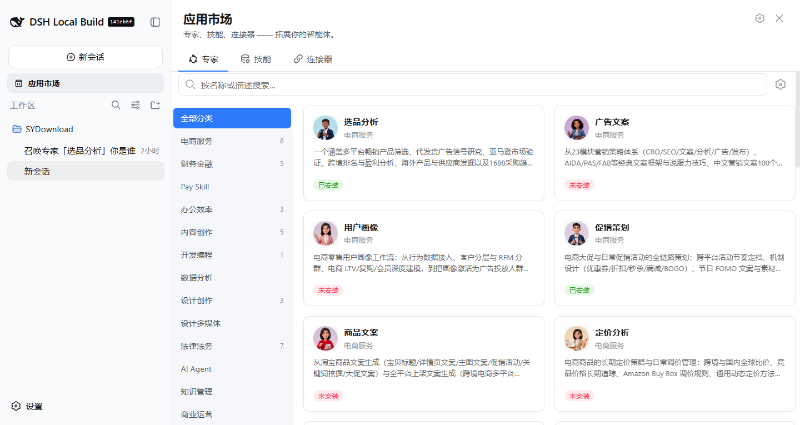
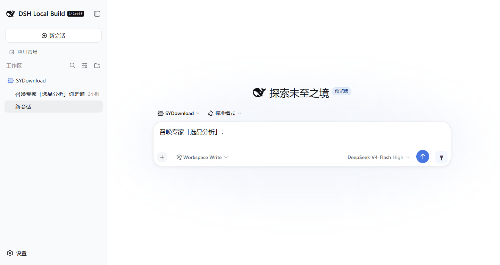
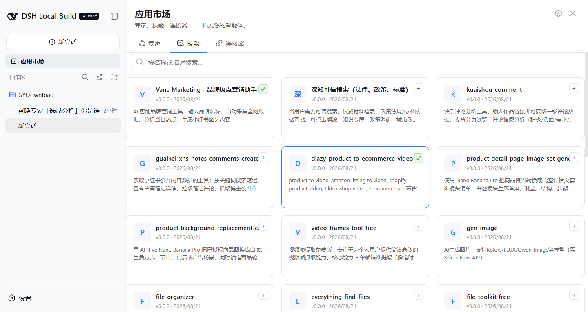
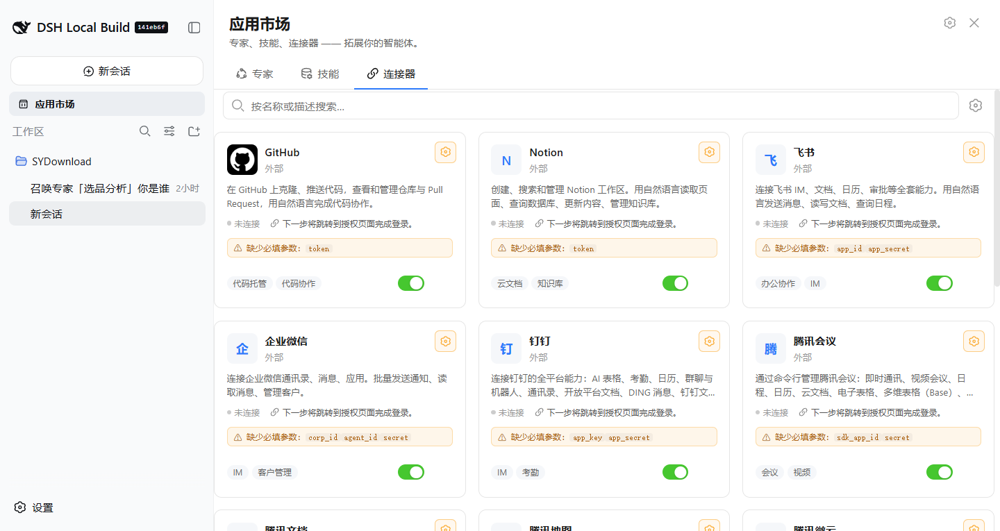

# @deepseek-ai/dsh-client-ui-marketplace

[](../../LICENSE)
[](https://www.npmjs.com/package/@deepseek-ai/dsh-client-ui-marketplace)

DeepSeek Harness Web 客户端的**应用市场**面板插件。它整合了三大目录 ——
**专家（Experts）**、**技能（Skills）** 与 **连接器（Connectors）**，数据来源于
[skill.dualpaw.com](https://skill.dualpaw.com) 注册中心，并支持在对话界面中直接
浏览、收藏、召唤（调用）与发布。

本插件是一个自包含的 Cordis 插件：仅注册 `locale` 能力，并通过
DOM 注入自己的侧边栏入口与中栏面板，**无需改动宿主网关或任何 slot**。

---

## 简介

应用市场插件在「技能中心」下方新增一个侧边栏入口。点击后接管中栏，展示三标签页面板：

| 标签页 | 内容 |
| --- | --- |
| **专家（Experts）** | 左侧分类栏 + 右侧专家卡片。悬浮卡片即可唤出 **召唤** 按钮。 |
| **技能（Skills）** | 可搜索的技能列表，工具栏提供 **发布技能** 操作。 |
| **连接器（Connectors）** | 连接器目录；每个连接器可预填对话框，并注入一个 🔌 切换芯片。 |

调用桥（invocation bridge）监听列表/详情组件派发的 `dsh:invoke-expert` /
`dsh:invoke-skill` / `dsh:connector-fill` 窗口事件：它会预填对话框、显示
「当前专家 / 当前技能」标识，并在对话框旁注入一个 🔌 芯片，弹出每连接器的开关浮层。

---

## 功能特性

### 1. 点击标签页自动加载
首次打开专家或技能标签页时，会按需从上游注册中心拉取对应目录
（`loadExperts()` / `loadSkills()`），面板秒开、数据懒加载。

### 2. ⚙ 参数设置 —— Token 与注册入口
面板头部的 **⚙** 图标打开共享的 **参数设置** 对话框
（`MarketplaceSettingsDialog`），可：

- 粘贴你的 API Token（**仅保存在本机**）。
- 一键跳转注册 / 获取 Token 页面：
  **<https://skill.dualpaw.com/register>**

Token 是解锁所有「写操作」的唯一凭证 —— 收藏专家、发布技能、需要真实鉴权的
连接器。纯本地操作（下载 / 召唤）不受 Token 影响。

### 3. 收藏（受 Token 限制）
保存 Token 后，专家与技能卡片会显示 **♥ 收藏** 角标按钮。未保存 Token 时
收藏是空操作，让界面如实反映「哪些操作真的会生效」。

### 4. 发布技能（受 Token 限制）
保存 Token 后，技能标签页工具栏显示 **发布技能** 按钮，打开
`PublishSkillDialog`。填写名称、描述与指令后提交，插件向注册中心 `/skills`
发起 `POST` 并刷新技能列表。未保存 Token 时会前置拦截并给出明确提示。

### 5. 悬浮 → 召唤（自动安装 + 「已安装」标识）
悬浮专家卡片即唤出 **召唤** 按钮：

- 按钮前缀图标显示安装状态 —— **✓ 已安装** / **⊘ 未安装**，点击瞬间翻转。
- 点击未安装专家的「召唤」会先调用 `installExpert`，按钮内显示
  **下载中 / 召唤中**，随后原子化自动下载该专家捆绑的技能，并派发
  `dsh:invoke-expert` 事件，由对话框接管后续流程。
- 已安装专家在卡片上保留 **已安装** 标识。

---

## 界面截图

| 面板 | 截图 |
| --- | --- |
| **专家页** — 左侧分类栏 + 带「已安装/未安装」标识的专家卡片。 |  |
| **召唤后** — 选中的专家已注入到对话框中。 |  |
| **技能页** — 可搜索的技能列表，支持收藏与发布。 |  |
| **连接器页** — 连接器目录及参数芯片。 |  |

---

## 环境准备

| 依赖项 | 版本要求 |
| --- | --- |
| Node.js | `^22.19 \|\| >=24` |
| 包管理器 | `pnpm`（仓库为 workspace 结构） |
| React | `^18.2.0`（peer） |
| DeepSeek API Key | 可选 —— 仅宿主以真实 Agent 运行 web 时需要 |

插件本身为纯前端，通过 `src/client/api.ts` 中的自有 CORS 中继访问
`skill.dualpaw.com`，注册中心不可达时回退到 Mock 数据，构建期无需任何密钥。

本包位于 DeepSeek Harness 单体仓库内（`packages/client/ui-marketplace`），
使用仓库统一的 `tsdown` 流水线构建。

---

## 安装

### 作为 workspace 包（开发）

在仓库根目录执行：

```sh
pnpm install
pnpm --filter @deepseek-ai/dsh-client-ui-marketplace bundle
```

`bundle`（基于 `tsdown`）将 `src/` 编译为运行时产物：

- `lib/index.js` — ESM 入口（宿主加载）。
- `lib/client.js` — web 客户端加载的浏览器端产物。

> ⚠️ 运行中的 web 客户端加载的是**编译后的 `lib/client.js`**，而非 `src/`。
> 修改 `src/` 后必须重新执行上面的 `bundle` 脚本（并重启 `dsh web`）改动才会生效。

### 启动宿主 web 客户端

```sh
pnpm dsh web --port 8080
# 打开 http://127.0.0.1:8080
```

在侧边栏点击 **应用市场** 入口即可打开面板。

---

## 使用说明

1. 打开侧边栏的 **应用市场** 入口。
2. 选择标签页 —— **专家 / 技能 / 连接器**。
3. 点击面板头部的 **⚙** 打开 **参数设置**：
   - 粘贴 API Token，或
   - 点击链接前往 <https://skill.dualpaw.com/register> 获取。
4. 保存 Token 后：
   - 用 **♥** 收藏专家 / 技能。
   - 在 **技能** 标签页点击 **发布技能** 发布新技能。
5. 悬浮专家卡片，点击 **召唤** 即可（如需）先安装再调用。已安装专家显示
   **已安装** 标识。

---

## 目录结构

```
packages/client/ui-marketplace/
├── src/client/
│   ├── index.ts                    # 插件入口（apply + locale 注册）
│   ├── store.ts                    # MarketplaceStore（目录、安装、收藏、发布）
│   ├── api.ts                      # 访问 skill.dualpaw.com 的 CORS 中继 + Mock 回退
│   ├── MarketplaceController.ts    # 面板开关 + 单占用协调
│   ├── MarketplacePanel.tsx        # 三标签页中栏面板
│   ├── ExpertsTab.tsx              # 专家网格 + 悬浮召唤 + 收藏
│   ├── SkillsTab.tsx               # 技能列表 + 发布工具栏操作
│   ├── ConnectorsTab.tsx           # 连接器目录 + 对话框芯片
│   ├── MarketplaceSettingsDialog.tsx  # ⚙ 参数设置（Token + 注册链接）
│   ├── PublishSkillDialog.tsx      # 发布技能对话框（Token 限制）
│   ├── invoke.ts                   # 调用桥（dsh:invoke-* 事件）
│   ├── locales.ts                  # 中英文 i18n 词典
│   └── styles.module.css           # CSS Modules
├── lib/                            # 构建产物（tsdown）—— 勿手改
├── tsdown.config.ts
└── package.json
```

---

## 免责声明

本插件为独立的社区贡献，**并非** DeepSeek AI 的官方产品。上游注册中心
`skill.dualpaw.com` 由第三方运营；你的 API Token 仅保存在本地浏览器中。
请自行评估风险，并在任何生产环境运行前审阅源码。

MIT 许可证。详见 [LICENSE](../../LICENSE)。
